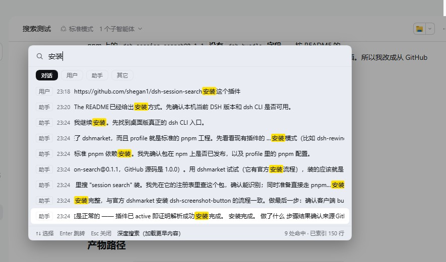

# DSH Session Search

中文 | [English](README.en.md)

Command-palette style search for the current DeepSeek Harness conversation. Open with `Ctrl+F` or the magnifier button in the session header, type a keyword for instant highlighted hits, filter by role, and press Enter to jump to the message with a keyword flash. Installs as a dsh bundle; no DSH source modifications.



## Usage

- **`Ctrl+F`** (or the header magnifier button): open the search panel;
- Type a keyword: instant hits from the session's loaded content (role badge + time + highlighted snippet);
- **↑↓** to select, **Enter** to jump (or click a result): the chat flow scrolls to the message, the row flashes and the keyword blinks bright-yellow twice;
- **Esc** / click the backdrop: close the panel;
- Role filter chips: **Conversation** (default: user + assistant messages) / **User** / **Assistant** / **Other** (tool results, commands, errors — machine-process rows, included only when explicitly selected);
- **Deep search (load earlier content)**: the panel footer button. Pages older history in the background through the host's `loadOlder` channel (the chat flow does not scroll) and rebuilds the index per page; two pages without growth means "reached the top". Typing keeps working during the run, cancellation is one click, 200-page cap.

## Install

```sh
dsh plugin --profile web add dsh-session-search
```

Or search for "session search" in the dshmarket plugin marketplace.

Requirements: DSH desktop ≥ 0.2.1 (Windows / macOS; pure front-end, no platform dependencies).

Install from source:

```sh
git clone https://github.com/shegan1/dsh-session-search
dsh plugin --profile web add ./dsh-session-search
```

## Implementation notes

The bundle is client-only (the host half `index.js` is an empty apply):

- **Search index**: one DOM scan of the chat flow per panel open — the host renders `data-chat-anchor-key` / `data-chat-flow-kind` / `data-chat-turn` per row as a version-stable public contract. Index content (`textContent`, collapsed bodies included) and jump targeting share one coordinate system, so a hit can never fail to land;
- **Time labels**: the host renders clocks only on user rows and turn-tail rows (spans whose CSS class contains `timeStart`/`timeEnd`; hover-only visible but always in the DOM). The plugin locates them by class; every other row inherits the nearest same-turn tail's time, and results sort by parsed timestamp (`HH:MM` = today, `M月D日 HH:MM` = this year, `YYYY年M月D日 HH:MM` verbatim);
- **Jump**: the target row's offset inside the scrollport is computed and `scrollTop` is set directly (deterministic single-frame scroll that beats the host's bottom-follow / scroll-anchoring), with one follow-up write on the next frame. Hidden rows inside collapsed groups are filtered from the index; an invisible exact match falls to the nearest visible row;
- **Keyword flash**: the CSS Custom Highlight API wraps the needle inside the target row, blinks twice, then unregisters — no residue in host DOM;
- **Deep search**: pages history through the session's standard `loadOlder()` verb (viewport untouched), rebuilding the index per page; falls back to programmatic top-scrolling when `loadOlder` is unavailable.

Diagnostics go to the browser Console (`[session-search]` prefix: indexed row count, clock probes, per-jump lookup classification and before/after scroll positions).

## Known limitations

- The panel indexes only the **loaded** message window on open (the most recent page by default); older history is one click away via the footer **deep search**, which loads it in the background — no manual scrolling. Deep search caps at 200 pages; beyond that, trust the reached-the-top notice;
- Rows inside collapsed step-process groups are not searchable (the host keeps them `display:none`; jumping there would land nowhere). Expand the group and reopen the panel to include them;
- Time labels depend on the host's clock elements: if a future host build renames the clock classes, the time column goes silently missing (search and jump unaffected);
- Per-row text participates in matching up to 20k characters; the result list caps at 100 rows.
